# CasaVape 🛒

Aplicación móvil de comercio electrónico para la venta de cigarrillos electrónicos, líquidos, resistencias, accesorios e insumos relacionados, desarrollada por **Fuentes Facundo — Comisión A** como Proyecto Final de Programación Móvil (P3).

CasaVape permite a los clientes explorar el catálogo, comprar con envío a domicilio o retiro en local, y al personal de la tienda administrar el negocio (productos, pedidos, usuarios, auditoría y reportes) desde la misma aplicación.

> 📄 Este README reemplaza y actualiza la propuesta original del documento `ProyectoFinal-Programación Móvil-FuentesFacundo.docx` (escrito antes del desarrollo, con el nombre provisorio "VapeStore"). Todo lo descripto aquí **ya está implementado y verificado**. Las imágenes del documento original (DER, casos de uso y bocetos) se conservan en [`docs/images/guia`](docs/images/guia) como referencia.

---

## Índice

- [Arquitectura general](#arquitectura-general)
- [Tecnologías utilizadas](#tecnologías-utilizadas)
- [Funcionalidades](#funcionalidades)
  - [Cliente](#cliente)
  - [Administrador](#administrador)
- [Capturas de la aplicación](#capturas-de-la-aplicación)
- [Base de datos](#base-de-datos)
- [API REST](#api-rest)
- [Seguridad](#seguridad)
- [Pagos con Mercado Pago](#pagos-con-mercado-pago)
- [Reportes PDF](#reportes-pdf)
- [Chat con IA (Gemini)](#chat-con-ia-gemini)
- [Cómo ejecutar el proyecto](#cómo-ejecutar-el-proyecto)
- [Estructura del repositorio](#estructura-del-repositorio)

---

## Arquitectura general

La solución está compuesta por **tres proyectos** sobre una arquitectura cliente–servidor desacoplada:

```
┌─────────────────────┐        HTTP/JSON (JWT Bearer)        ┌─────────────────────┐
│  CasaVapeApp        │ ───────────────────────────────────► │  CasaVapeApi        │
│  (MAUI Blazor       │                                      │  (ASP.NET Core      │
│   Hybrid, Android)  │ ◄─────────────────────────────────── │  Web API REST)      │
└─────────────────────┘        respuestas JSON               └──────────┬──────────┘
                                                                          │
                                                                          ▼
                                                                ┌─────────────────────┐
                                                                │  SQL Server Express  │
                                                                │  BD "E-COMMERCE"     │
                                                                └─────────────────────┘
```

| Proyecto | Descripción |
|---|---|
| **`CasaVape.Core`** | Biblioteca compartida (net9.0): entidades de dominio, `ApplicationDbContext` (EF Core), DTOs y servicios comunes (auditoría, Mercado Pago, Gemini). Compartida por la API y la app. |
| **`CasaVapeApi`** | Web API REST (net9.0) con autenticación JWT, controladores de recursos, generación de PDFs (QuestPDF), integración con Mercado Pago y Gemini, rate limiting y servicios estáticos (imágenes de productos). |
| **`CasaVapeApp`** | App móvil Android (net10.0-android, .NET MAUI 10 + Blazor Hybrid): UI en Blazor con Bootstrap 5, consumo de la API vía `HttpClient` con token automático. |

La comunicación es **100 % mediante la API REST**: la app móvil nunca accede directamente a la base de datos. El estado del carrito se persiste localmente (`Preferences`), y los tokens de sesión en `SecureStorage` del dispositivo.

---

## Tecnologías utilizadas

| Área | Tecnología |
|---|---|
| Lenguaje | C# / .NET |
| App móvil | .NET MAUI 10 con **Blazor Hybrid** (`BlazorWebView`), Android (API 24+) |
| Backend | ASP.NET Core Web API (net9.0) |
| ORM | Entity Framework Core 9 (SQL Server) |
| Autenticación | ASP.NET Identity + **JWT** (access + refresh tokens) |
| UI | Blazor components, **Bootstrap 5** (tema Zephyr de Bootswatch), SweetAlert2, modo claro/oscuro |
| PDF | **QuestPDF** (comprobantes de pedido y reporte de pedidos) |
| Pagos | **Mercado Pago** (Checkout Pro / Orders API) |
| IA | **Google Gemini** (chat de asistencia sobre el catálogo) |
| Almacenamiento local | `Preferences` (carrito, tema) y `SecureStorage` (tokens) |
| Documentación API | OpenAPI (`MapOpenApi` en desarrollo) |
| Base de datos | SQL Server Express |

---

## Funcionalidades

La aplicación distingue dos roles: **Cliente** y **Administrador**, con permisos diferenciados tanto en la UI (rutas protegidas) como en la API (atributos `[Authorize(Roles = ...)]`).

### Cliente

- **Catálogo público** navegable sin registrarse: grilla de productos activos con imagen, categoría, precio y stock, paginado (12 por página) y filtrable por búsqueda y categoría.
- **Detalle de producto** con imagen, descripción, precio, disponibilidad y selección de cantidad.
- **Registro e inicio de sesión** (email + contraseña, validación de edad implícita por fecha de nacimiento).
- **Carrito de compras** persistente en el dispositivo: agregar, cambiar cantidades (limitado por stock), quitar ítems y ver el total.
- **Checkout completo**: selección de dirección de envío, método de entrega (retiro en local / envío a domicilio con costo) y medio de pago (**Efectivo**, **Transferencia por QR**, **Mercado Pago**), con resumen de totales antes de confirmar.
- **Mis pedidos**: historial con estado (`Pendiente → Pagado → Enviado → Entregado` / `Cancelado`), detalle de ítems, pagos y **descarga del comprobante en PDF**.
- **Mi cuenta**: edición de datos personales y cambio de contraseña.
- **Mis direcciones**: alta, edición y baja de direcciones de envío (con provincias precargadas).
- **Chat de IA** para consultar sobre productos.
- **Política de privacidad** integrada.

### Administrador

- **Gestión de productos**: alta/edición/baja con carga de imagen (`.jpg`, `.png`, `.gif`, `.webp` subida vía multipart, guardada por la API en `wwwroot/images/productos`), control de precio, stock, categoría y estado activo/inactivo (los productos con pedidos asociados solo pueden desactivarse, no eliminarse).
- **Gestión de categorías** y de **métodos de entrega** (nombre y costo de envío).
- **Gestión de pedidos**: listado con filtros por estado y número; detalle completo con ítems, dirección y pago; **transiciones de estado validadas** (Pendiente→Pagado→Enviado→Entregado; Cancelado desde Pendiente/Pagado con **reposición automática de stock**); **confirmar/rechazar pago** (rechazar cancela el pedido y repone stock); descarga de comprobante.
- **Gestión de usuarios**: listado con roles y cantidad de pedidos, asignación de roles (Cliente/Administrador) y **reset de contraseña**.
- **Auditoría**: registro de todas las operaciones sensibles (creaciones, ediciones, eliminaciones, cambios de estado, pagos) con usuario, fecha, valores anteriores/nuevos e IP; consultable con filtros (usuario, entidad, acción, rango de fechas) y paginación.
- **Reportes**: estadísticas de pedidos (cantidad, total facturado, ticket promedio) con filtros por fecha y estado, y **exportación a PDF** (QuestPDF).

---

## Capturas de la aplicación

Capturas reales de la app Android corriendo contra la API (más bocetos de la guía original en [`docs/images/guia`](docs/images/guia)).

### Cliente

| | |
|---|---|
| 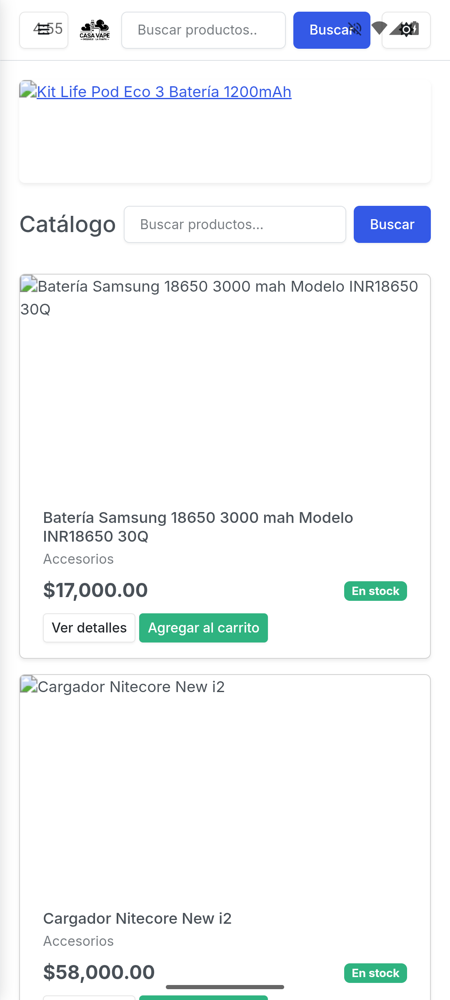 | 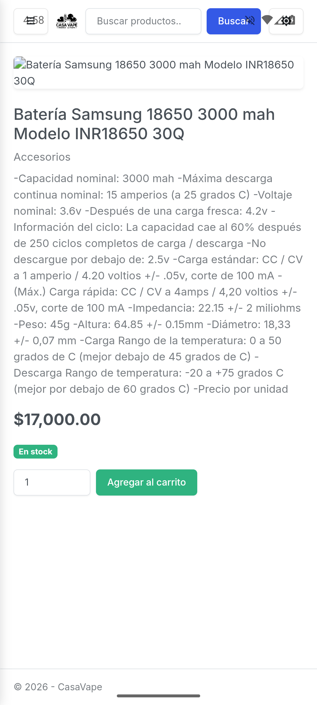 |
| *Catálogo público* | *Detalle de producto* |
| 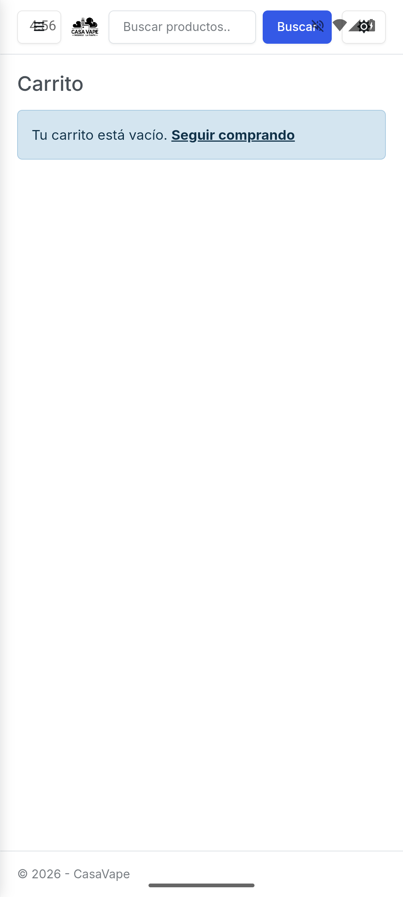 | 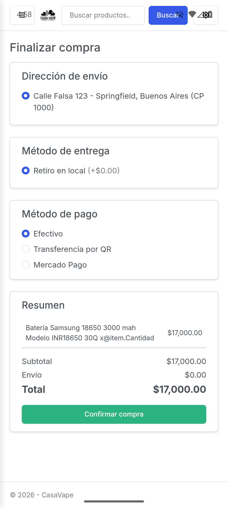 |
| *Carrito* | *Checkout: dirección, entrega y pago* |
| 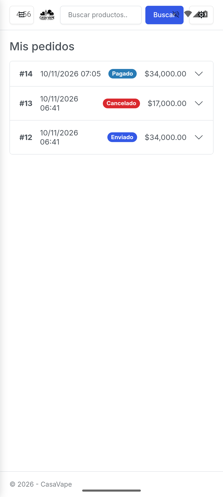 | 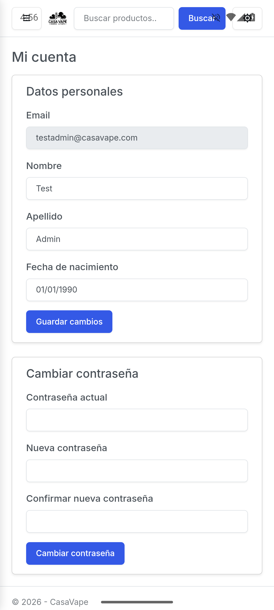 |
| *Mis pedidos (con comprobante PDF)* | *Mi cuenta* |
| 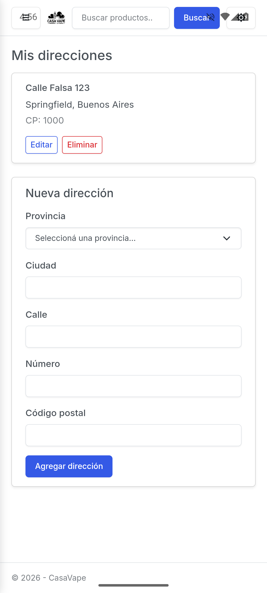 | 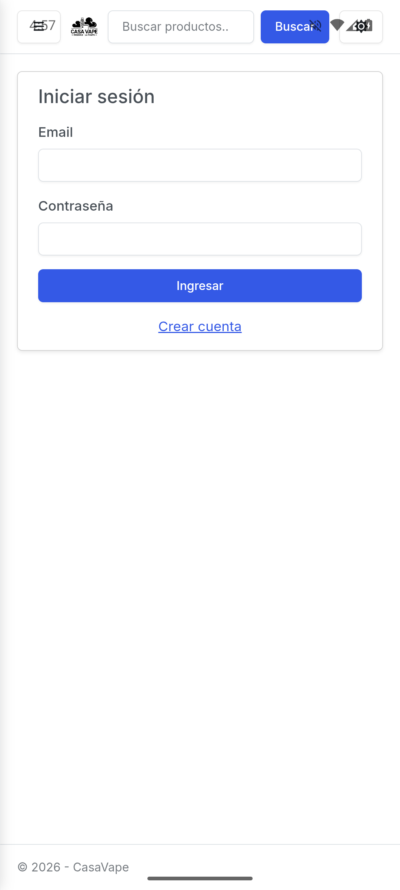 |
| *Mis direcciones* | *Inicio de sesión* |

### Administrador

| | |
|---|---|
| 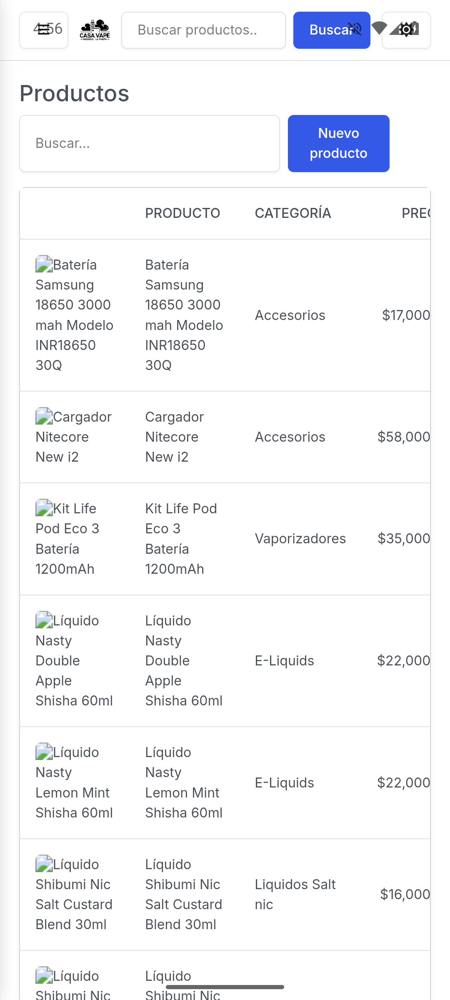 | 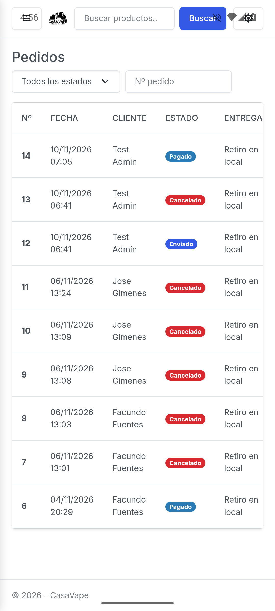 |
| *Gestión de productos* | *Gestión de pedidos* |
| 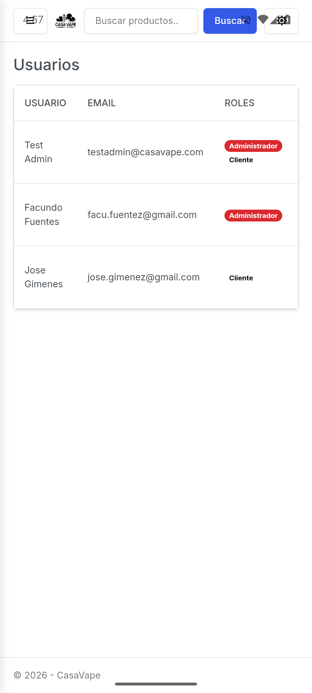 | 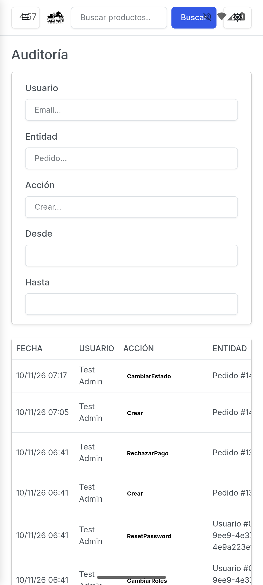 |
| *Gestión de usuarios y roles* | *Auditoría con filtros* |
| 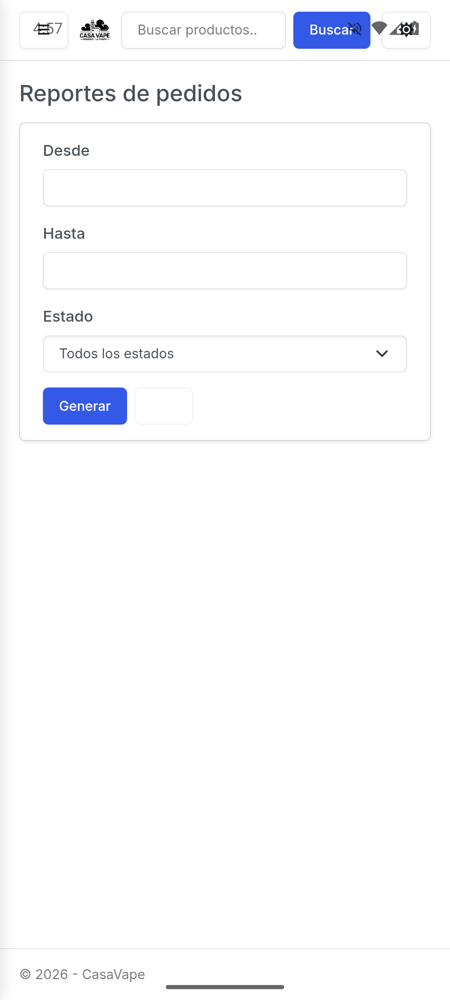 | 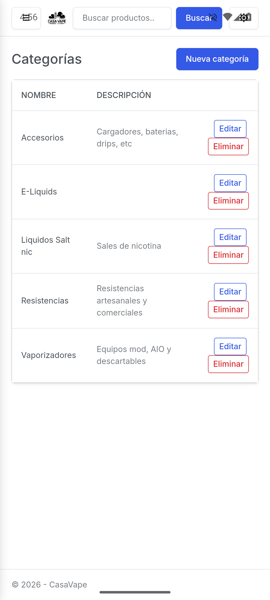 |
| *Reportes con exportación PDF* | *Gestión de categorías* |

---

## Base de datos

SQL Server Express, base de datos **`E-COMMERCE`** (compartida con el proyecto MVC de referencia). Diseño del DER (actual):

.png)

Diseño del DER (imagen original de la propuesta):

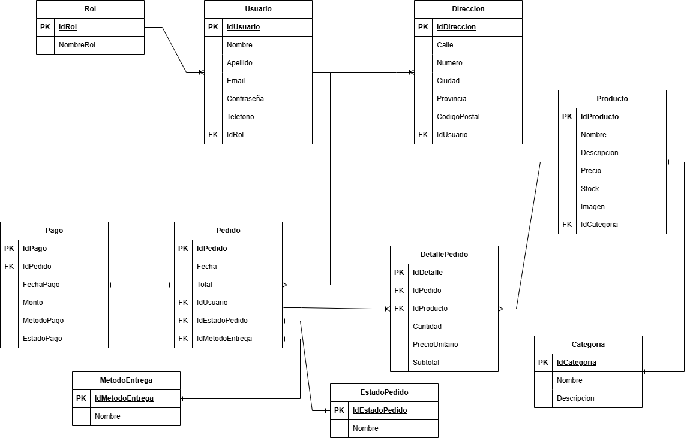

Diagrama de casos de uso de la propuesta original:

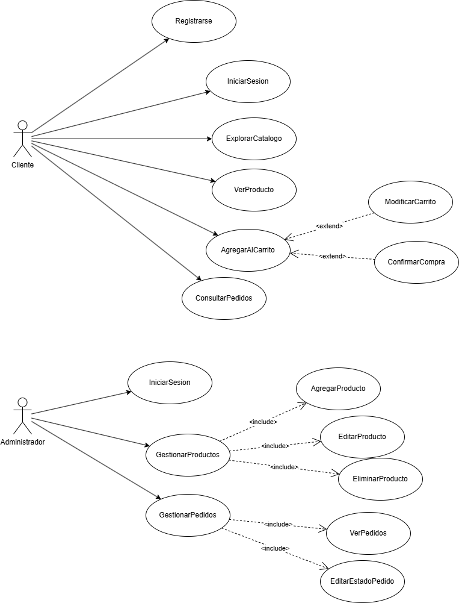

Entidades principales:

- **Identity**: `AspNetUsers` (con `Nombre`, `Apellido`, `FechaNacimiento`), `AspNetRoles`, `AspNetUserRoles`, `AspNetUserTokens` (refresh tokens).
- **Catálogo**: `Productos` (precio, stock, `ImagenUrl`, `Activo`), `Categorias`.
- **Ventas**: `Pedidos` (estado, método de entrega, dirección de envío, costo de envío, fecha), `DetallesPedido`, `EstadosPedido` (`Pendiente`, `Pagado`, `Enviado`, `Entregado`, `Cancelado`), `Pagos` (método, estado, monto, `IdMercadoPago`), `MetodosEntrega`.
- **Geografía**: `Direcciones` (por usuario, con `Activa` para baja lógica), `Provincias` (24 precargadas).
- **Integraciones**: `MercadoPagoCheckouts` (órdenes de checkout MP con items JSON y estado).
- **Auditoría**: `Auditorias` (usuario, acción, entidad, valores anteriores/nuevos JSON, IP, fecha).

La inicialización de datos semilla al arrancar la API (`SeedData.InitializeAsync`) crea los roles (`Cliente`, `Administrador`), el usuario administrador, las 24 provincias y los 5 estados de pedido.

---

## API REST

Todas las rutas bajo `/api`. Autenticación JWT Bearer salvo endpoints marcados como anónimos.

| Recurso | Endpoints | Acceso |
|---|---|---|
| **Auth** | `POST /auth/register`, `POST /auth/login`, `POST /auth/refresh`, `POST /auth/logout`, `GET /auth/me`, `PUT /auth/profile`, `POST /auth/change-password` | register/login anónimos; resto autenticado |
| **Products** | `GET /products` (`q`, `categoryId`, `page`, `pageSize`, `todos`), `GET /products/{id}`, `GET /products/categories`, `POST`, `PUT /{id}`, `DELETE /{id}` (multipart con `imagenArchivo`) | lectura anónima; escritura admin |
| **Categories** | `GET`, `POST`, `PUT /{id}`, `DELETE /{id}` | lectura anónima; escritura admin |
| **ShippingMethods** | `GET`, `POST`, `PUT /{id}`, `DELETE /{id}` | lectura anónima; escritura admin |
| **Addresses** | `GET`, `POST`, `PUT /{id}`, `DELETE /{id}`, `GET /addresses/provinces` | autenticado (dueño) |
| **Orders** | `GET /orders` (propios), `GET /orders/{id}`, `POST /orders/checkout`, `GET /orders/{id}/receipt` (PDF) | autenticado |
| **Orders (admin)** | `GET /orders/admin` (`estado`, `q`, `page`), `PUT /orders/{id}/status`, `POST /orders/{id}/confirm-payment`, `POST /orders/{id}/reject-payment`, `GET /orders/admin/reporte`, `GET /orders/admin/reporte/pdf` | Administrador |
| **Users (admin)** | `GET /admin/users`, `PUT /admin/users/{id}/roles`, `POST /admin/users/{id}/reset-password` | Administrador |
| **Audits (admin)** | `GET /admin/audits` (`usuario`, `entidad`, `accion`, `desde`, `hasta`, `page`, `pageSize`) | Administrador |
| **Chat** | `POST /chat` (asistente IA sobre catálogo, rate limit 15/min) | autenticado |
| **Mercado Pago** | `POST /mercadopago/webhook` (notificaciones), `GET /mercadopago/checkout/{id}/status` | webhook público firmado |

El **checkout** valida dirección y método de entrega del usuario, stock y activo de cada producto, y el medio de pago (`Efectivo`, `Transferencia por QR`, `Mercado Pago`). Con Efectivo/QR crea el pedido en estado `Pendiente` con pago pendiente de verificación; con Mercado Pago crea la orden en MP y devuelve la `CheckoutUrl` para completar el pago (ver [Pagos con Mercado Pago](#pagos-con-mercado-pago)).

---

## Seguridad

- **Autenticación JWT** con validación de emisor, audiencia, vida útil y firma (`TokenValidationParameters`). Access token + **refresh token** persistidos en `SecureStorage` del dispositivo (cifrado por el SO).
- **Autorización por roles**: endpoints administrativos protegidos con `[Authorize(Roles = "Administrador")]`; la app replica el control en el enrutado (`AuthorizeRouteView`) y en el menú (`AuthorizeView`).
- **ASP.NET Identity** para hash de contraseñas (PBKDF2), política de contraseñas (mínimo 6, un dígito) y email único.
- **Aislamiento de datos**: cada usuario solo consulta sus direcciones y pedidos; los endpoints verifican la propiedad (o rol admin) antes de responder.
- **Rate limiting** en el endpoint de chat (15 req/min por IP) para contener el costo de la IA.
- **Webhook de Mercado Pago** validado con firma (`MP_WEBHOOK_SECRET`).
- **Secretos fuera del código**: claves (JWT, Mercado Pago, Gemini) se cargan desde variables de entorno / archivo `.env` (ignorado por git, ver `.env.example`); nunca versionadas.
- **Baja lógica** de direcciones y productos (campo `Activa`/`Activo`) y **protección de integridad referencial** (no se eliminan productos con pedidos; la cancelación repone stock dentro de la misma transacción).
- **Auditoría completa** de operaciones sensibles con valores antes/después e IP del cliente.

---

## Pagos con Mercado Pago

Integración con **Checkout Pro (Orders API)**:

1. El cliente elige Mercado Pago en el checkout → la API valida y crea un `MercadoPagoCheckout` con los ítems.
2. Se crea la orden en MP con URLs de retorno (éxito/fallo/pendiente) y se devuelve la `CheckoutUrl`.
3. La app abre la URL en el navegador externo del dispositivo (`Launcher.OpenAsync`).
4. **Webhook** `POST /api/mercadopago/webhook` recibe la notificación de pago (validada con la firma secreta) y aprueba el pago + pedido automáticamente.

Si no hay credenciales configuradas (`MP_ACCESS_TOKEN`), el endpoint rechaza el medio de pago con un mensaje claro, sin afectar los otros métodos. Los pagos con **Transferencia por QR** incluyen el QR de transferencia en el comprobante PDF y son verificados manualmente por el administrador (confirmar/rechazar pago).

---

## Reportes PDF

Generados con **QuestPDF** (licencia comunitaria):

- **Comprobante de pedido** (`GET /api/orders/{id}/receipt`): datos del cliente, dirección de envío, ítems con subtotales, totales, datos del pago y, si el pago es "Transferencia por QR" pendiente, el **código QR de transferencia**. Disponible para cliente (su pedido) y admin (cualquiera).
- **Reporte de pedidos** (`GET /api/orders/admin/reporte/pdf`, admin): listado filtrable por fecha y estado con encabezado, filtros aplicados, totales por pedido y total general.

La app descarga los PDF a su almacenamiento privado (`FileSystem.AppDataDirectory`) y los abre con el visor del sistema (`Launcher.OpenAsync` con `OpenFileRequest`).

---

## Chat con IA (Gemini)

La API expone `POST /api/chat` que responde preguntas sobre el catálogo usando **Google Gemini** (modelo configurable vía `GEMINI_MODEL`). El contexto del modelo se alimenta con los productos activos para responder con información real de la tienda. Protegido con rate limiting y disponible solo para usuarios autenticados.

---

## Cómo ejecutar el proyecto

### Requisitos

- .NET 10 SDK (incluye soporte MAUI) y .NET 9 runtime
- Carga de trabajo de MAUI Android: `dotnet workload install maui-android`
- SQL Server Express con la base `E-COMMERCE` (ver cadena de conexión en `CasaVapeApi/appsettings.json`)
- Emulador o dispositivo Android (API 24+)

### 1. Backend

```bash
cd CasaVapeApi
# opcional: crear .env con JWT_SECRET, MP_ACCESS_TOKEN, GEMINI_API_KEY (ver .env.example)
dotnet run
# API en http://localhost:5178 (perfil http)
```

El seed inicial crea los roles, el usuario administrador, las provincias y los estados de pedido.

### 2. App Android

La app apunta a la API vía el alias de loopback del emulador (`http://10.0.2.2:5178/`, configurado en `MauiProgram.cs`).

```bash
cd CasaVapeApp
dotnet build -t:Run -f net10.0-android -p:AndroidDevice=emulator-5554
# o abrir la solución en Visual Studio y F5 en un emulador/dispositivo
```

> Para deploy manual del APK: `dotnet build CasaVapeApp -p:EmbedAssembliesIntoApk=true` (Debug) o Release, e instalar con `adb install`.

### 3. Solución completa

La solución `CasaVape.slnx` incluye los tres proyectos; compilarla requiere las cargas de trabajo de Android instaladas.

---

## Estructura del repositorio

```
CasaVape/
├── CasaVape.slnx                        # Solución (Core, Api, App)
├── README.md
├── ProyectoFinal-Programación Móvil-FuentesFacundo.docx   # Propuesta original (guía)
├── docs/
│   └── images/
│       ├── guia/                         # DER, casos de uso y bocetos del docx original
│       └── app/                           # Capturas reales de la app
├── CasaVape.Core/                        # Biblioteca compartida (net9.0)
│   ├── Data/                              # ApplicationDbContext, SeedData
│   ├── Models/                            # Entidades (Entities, Identity)
│   ├── DTOs/                              # DTOs de request/response
│   └── Services/                          # AuditoriaService, MercadoPagoService, GeminiChatService
├── CasaVapeApi/                           # Web API REST (net9.0)
│   ├── Controllers/                       # Auth, Products, Categories, Orders, Addresses,
│   │                                      # ShippingMethods, Users, Audits, Chat, MercadoPago
│   ├── Services/                          # TokenService, PedidoReporteService (QuestPDF)
│   ├── wwwroot/images/productos/          # Imágenes de productos servidas estáticamente
│   ├── Program.cs                         # JWT, DI, rate limiting, seed, .env loader
│   └── .env.example                       # Variables de entorno esperadas
└── CasaVapeApp/                           # App MAUI Blazor Hybrid (net10.0-android)
    ├── Components/
    │   ├── Layout/                        # MainLayout (sidebar + tema), NavMenu
    │   ├── Pages/                         # Home, Login, Register, ProductDetails, Cart, Checkout,
    │   │                                  # Pedidos, Cuenta, Direcciones, Privacidad,
    │   │                                  # Admin{Productos,Categorias,Pedidos,Usuarios,Auditoria,Reportes}
    │   └── Shared/                        # ProductCard, RedirectToLogin
    ├── Services/                          # Auth, Product, Cart, Order, Address, Account, Category,
    │                                      # AdminUser, Audit, ShippingMethod, AuthHeaderHandler,
    │                                      # JwtAuthenticationStateProvider
    ├── Models/                            # CartItem, DTOs locales
    └── wwwroot/                           # index.html, CSS, logo, placeholder de imagen
```

---

## Autor

**Fuentes Facundo** — Comisión A — Programación Móvil (P3), Proyecto Final.
